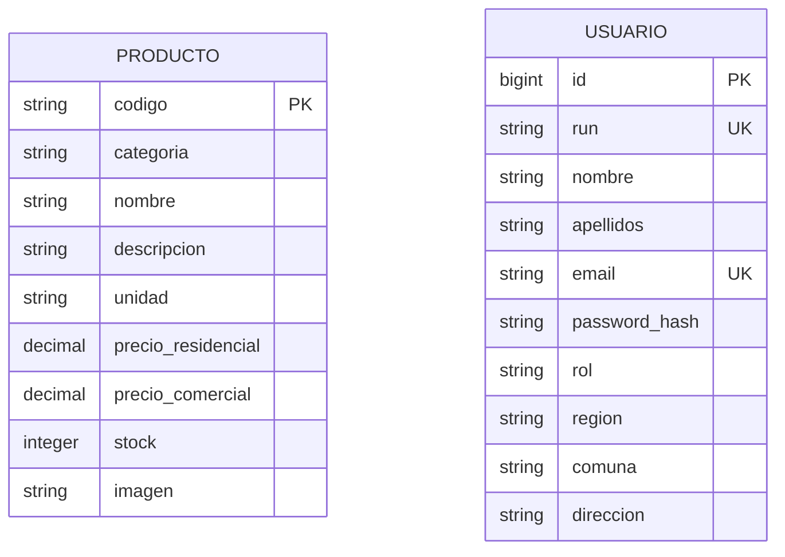
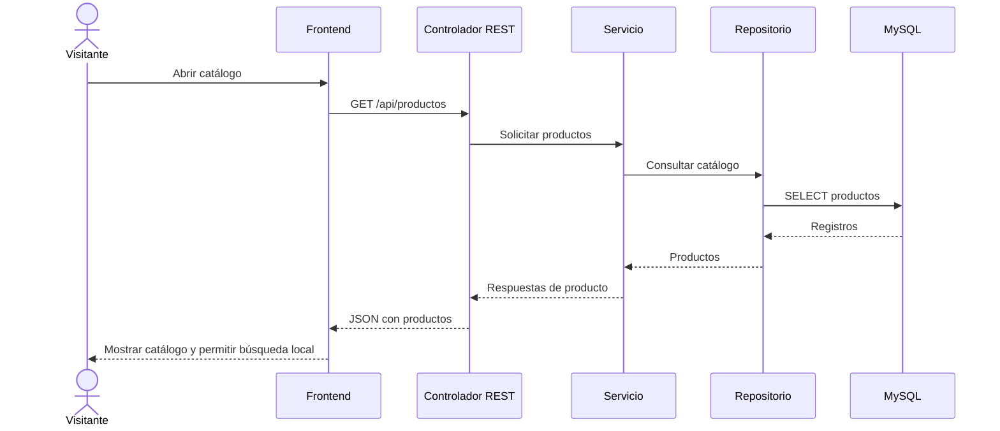
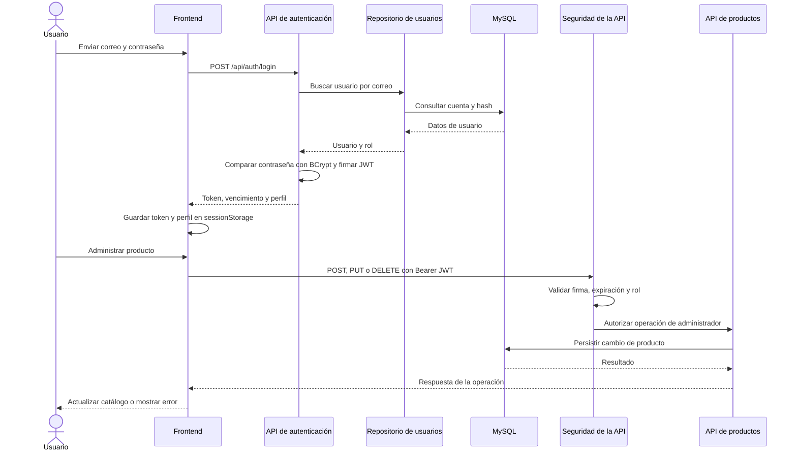

# Especificación de Requisitos del Software (ERS)

- **Sistema:** Sitio web Gas El Volcán
- **Versión:** 0.1
- **Fecha:** 24 de noviembre de 2026
- **Formato:** Propio, adaptado para la evaluación académica de Fullstack 2

> Este documento usa un formato propio y se elaboró con la rúbrica completa
> compartida, las capturas de las pantallas de acceso, registro y selección, la
> presentación técnica descrita en la conversación y el comportamiento actual
> de la aplicación. No pretende reproducir una plantilla oficial de Fullstack
> 1. Si el docente entrega un formato específico, este contenido se puede
> trasladar a ese formato.

## 1. Introducción

### 1.1 Propósito

Definir los requisitos funcionales y de calidad del sitio Gas El Volcán para
que el equipo pueda implementarlo, probarlo y demostrarlo de forma coherente
con la evaluación.

### 1.2 Alcance del producto

El sistema presenta el catálogo de productos de Gas El Volcán, permite a los
visitantes consultar productos y mantener una selección local, permite crear
cuentas de cliente e iniciar sesión, y entrega a los administradores
autorizados herramientas para gestionar productos.

La selección y los formularios de reserva y contacto son informativos y
demostrativos. No crean pedidos, no procesan pagos y no envían ni guardan
solicitudes en el servidor.

### 1.3 Fuentes consideradas

- Capturas compartidas de la rúbrica, con criterios visibles IE3.1.1 a
  IE3.3.6.
- Capturas de las pantallas de inicio de sesión, registro y solicitud de
  reserva.
- Requisitos de arquitectura, REST, MySQL y Flyway de la presentación técnica
  descrita durante el trabajo.
- Revisión del frontend y backend actuales.

La presentación de referencia incluye ejemplos de otro dominio. Para este
proyecto, las operaciones CRUD se aplican al catálogo de productos de Gas El
Volcán, no a entidades de Pokémon.

## 2. Alcance y supuestos

### Scope Baseline

- **Método de descubrimiento:** contraste de la rúbrica completa y las fuentes
  anteriores con las pantallas y comportamiento actuales del sistema.
- **Requisitos identificados:** 24 requisitos, numerados desde REQ-001 hasta
  REQ-024.
- **Requisitos en alcance:** 24.
- **Fuera de alcance explícito:** pagos, creación de pedidos reales, reserva
  persistida en el servidor, envío de mensajes de contacto y autoprovisión
  pública de administradores.

### 2.1 Supuestos y decisiones pendientes

- El registro público siempre crea una cuenta de cliente. La asignación del
  rol de administrador es una tarea controlada de administración de la base
  de datos.
- El precio de la selección es referencial; la disponibilidad y el valor final
  deben confirmarse con el equipo de atención.
- Las solicitudes de reserva y los mensajes de contacto son demostrativos y no
  se guardan en el servidor. Esta decisión se basa en las pantallas actuales y
  en que los criterios visibles de la rúbrica se centran en productos,
  autenticación y permisos.
- El formulario ofrece actualmente un conjunto acotado de regiones y comunas
  chilenas. La cobertura geográfica completa no está definida en las fuentes
  visibles.

## 3. Usuarios y perfiles

| Perfil | Necesidades y permisos |
|---|---|
| Visitante | Navegar el sitio, consultar y buscar productos, ver detalles y crear una cuenta. |
| Cliente | Iniciar sesión y usar las funciones disponibles para clientes. No puede administrar el catálogo. |
| Administrador | Administrar productos desde el panel, con autorización validada por el backend. |
| Responsable técnico | Configurar servicios, base de datos, secretos y permisos del entorno. |

## 4. Escenarios de usuario y pruebas

### Historia 1 — Consultar productos (Prioridad P1)

Como visitante, quiero explorar el catálogo y encontrar un producto por nombre,
código o categoría para conocer las opciones disponibles.

**Importancia:** Es el flujo principal de consulta del negocio y demuestra la
integración del catálogo.

**Prueba independiente:** Abrir el catálogo con el backend activo, buscar un
producto conocido y abrir su detalle.

**Escenarios de aceptación:**

1. **Dado** que el servicio de productos está disponible, **cuando** el
   visitante abre el catálogo, **entonces** se muestran los productos recibidos
   desde el sistema.
2. **Dado** un término que coincide con un producto, **cuando** el visitante
   ejecuta la búsqueda, **entonces** se muestran los resultados coincidentes y
   su cantidad.
3. **Dado** un término sin coincidencias, **cuando** se ejecuta la búsqueda,
   **entonces** se informa que no se encontraron productos.

### Historia 2 — Crear una cuenta e iniciar sesión (Prioridad P1)

Como cliente, quiero registrarme e iniciar sesión para que el sistema reconozca
mi identidad y rol.

**Importancia:** La evaluación exige autenticación basada en JWT, roles y
gestión de sesión.

**Prueba independiente:** Registrar un cliente con datos válidos, iniciar
sesión y comprobar la sesión; usar credenciales incorrectas para comprobar el
rechazo.

**Escenarios de aceptación:**

1. **Dado** un RUN y correo válidos que no estén registrados, **cuando** se
   completa el registro, **entonces** se crea una cuenta de cliente.
2. **Dado** un correo y contraseña válidos, **cuando** el usuario inicia
   sesión, **entonces** el sistema reconoce su identidad y rol.
3. **Dadas** credenciales inválidas, **cuando** se intenta iniciar sesión,
   **entonces** se informa el error sin iniciar una sesión.

### Historia 3 — Administrar productos (Prioridad P1)

Como administrador, quiero crear, actualizar y eliminar productos para mantener
el catálogo vigente.

**Importancia:** El CRUD y la protección de acciones administrativas son
criterios explícitos de la evaluación.

**Prueba independiente:** Con una cuenta autorizada, crear un producto
temporal, actualizarlo, comprobar los cambios y eliminarlo.

**Escenarios de aceptación:**

1. **Dado** un administrador autenticado y datos válidos, **cuando** crea un
   producto, **entonces** el producto queda disponible en el catálogo.
2. **Dado** un producto existente, **cuando** el administrador lo actualiza,
   **entonces** los cambios aparecen al volver a consultar el catálogo.
3. **Dado** un producto existente, **cuando** el administrador confirma su
   eliminación, **entonces** deja de aparecer en el catálogo.
4. **Dado** un visitante o cliente sin rol administrador, **cuando** intenta
   modificar productos, **entonces** el backend rechaza la operación.

### Historia 4 — Mantener una selección referencial (Prioridad P2)

Como visitante o cliente, quiero agregar y quitar productos de mi selección
para revisar una solicitud referencial antes de contactar al equipo.

**Prueba independiente:** Agregar un producto, recargar la página, quitarlo y
comprobar el total referencial.

**Escenarios de aceptación:**

1. **Dado** un producto del catálogo, **cuando** se agrega a la selección,
   **entonces** aparece una sola vez en la lista.
2. **Dada** una selección con productos, **cuando** se quita un producto,
   **entonces** desaparece y se recalcula el total referencial.
3. **Dada** una solicitud de reserva válida, **cuando** se envía, **entonces**
   se informa que es simulada y que no se creó un pedido real.

### Historia 5 — Enviar una consulta de contacto demostrativa (Prioridad P3)

Como visitante, quiero completar el formulario de contacto para revisar la
validación de los datos y conocer los canales de atención.

**Prueba independiente:** Completar el formulario con datos válidos y comprobar
el mensaje informativo; probar también datos inválidos.

**Escenarios de aceptación:**

1. **Dado** un formulario incompleto o inválido, **cuando** se intenta enviar,
   **entonces** se informa qué datos deben corregirse.
2. **Dado** un formulario válido, **cuando** se envía, **entonces** la interfaz
   aclara que no se transmitió la consulta a un servidor.

### Casos límite

- El backend no está disponible o devuelve un error: el sitio muestra el
  problema y permite reintentar la carga del catálogo.
- La búsqueda no devuelve resultados: se muestra un estado vacío claro.
- El correo o RUN ya existe: el registro informa el conflicto y no duplica la
  cuenta.
- El token vence o una operación protegida devuelve `401`: la sesión se limpia
  y se solicita autenticarse nuevamente.
- Un cliente intenta acceder al panel o ejecutar un CRUD: el frontend
  restringe el acceso y el backend aplica la autorización definitiva.
- Se solicita un producto inexistente: la API responde `404`.

## 5. Requisitos

### 5.1 Requisitos funcionales

- **REQ-001:** El sitio debe ofrecer navegación a Inicio, Nosotros, Catálogo,
  Novedades, Contacto, Acceso y Mi selección.
- **REQ-002:** El catálogo debe obtener los productos del servicio de datos y
  mostrar un estado de carga, error y reintento cuando corresponda.
- **REQ-003:** El visitante debe poder abrir el detalle de un producto usando
  su código.
- **REQ-004:** La búsqueda debe filtrar por nombre, código, categoría o
  descripción y mostrar una cantidad de resultados o un mensaje sin resultados.
- **REQ-005:** El usuario debe poder agregar productos a Mi selección sin
  duplicar un mismo código.
- **REQ-006:** El usuario debe poder quitar productos de la selección y ver un
  total referencial basado en el precio residencial.
- **REQ-007:** La solicitud de reserva debe validar nombre, teléfono y
  dirección, e indicar claramente que no genera ni transmite un pedido real.
- **REQ-008:** El formulario de contacto debe validar sus campos e indicar que
  el mensaje no se envía a un servidor.
- **REQ-009:** El registro debe validar RUN, nombre, apellidos, correo,
  contraseña, región, comuna y dirección.
- **REQ-010:** El sistema debe rechazar RUN o correos duplicados y asignar el
  rol Cliente al registro público, sin permitir que el solicitante elija el
  rol Administrador.
- **REQ-011:** El inicio de sesión debe validar correo y contraseña y entregar
  una sesión autenticada con el rol correspondiente y vencimiento definido.
- **REQ-012:** La sesión debe sobrevivir a una recarga mientras el token siga
  vigente y debe poder finalizarse explícitamente mediante Cerrar sesión.
- **REQ-013:** El navbar debe mostrar el acceso al panel solo a un usuario
  administrador y ofrecer Cerrar sesión cuando hay una sesión activa.
- **REQ-014:** El panel debe impedir el acceso a visitantes y clientes; el
  control del frontend no sustituye la autorización del backend.
- **REQ-015:** El administrador debe poder crear, editar y eliminar productos
  con código, categoría, nombre, descripción, unidad, precios residencial y
  comercial, stock e imagen. El código de un producto nuevo lo asigna el
  sistema.
- **REQ-016:** La API debe permitir consultar productos públicamente y
  restringir las operaciones de creación, actualización y eliminación al rol
  Administrador.
- **REQ-017:** El sistema debe aplicar validaciones de datos y comunicar de
  forma comprensible errores de validación, autenticación, permisos, datos
  duplicados y recursos inexistentes.
- **REQ-018:** Una instalación nueva debe contar con el catálogo inicial de
  productos provisto por la migración de datos, sin duplicar códigos ya
  existentes.

### 5.2 Requisitos de calidad y restricciones

- **REQ-019:** Las contraseñas deben almacenarse como hashes BCrypt y nunca
  devolverse en las respuestas de autenticación.
- **REQ-020:** Los tokens deben estar firmados, incluir expiración y ser
  validados por el backend; la clave de firma debe configurarse fuera del
  código fuente.
- **REQ-021:** Las contraseñas, roles y operaciones administrativas deben
  protegerse en el backend, incluso si un usuario evita la interfaz.
- **REQ-022:** La persistencia del sistema debe mantener la integridad de
  productos y usuarios mediante restricciones y migraciones de esquema
  versionadas.
- **REQ-023:** En el entorno de evaluación local, el catálogo inicial de 14
  productos debe mostrarse en menos de 3 segundos cuando frontend, API y base
  de datos están disponibles. Este objetivo debe medirse en el entorno de
  demostración.
- **REQ-024:** La documentación debe distinguir entre operaciones reales
  persistidas y funciones demostrativas que no envían datos.

### 5.3 Interfaces externas

| Interfaz | Operaciones |
|---|---|
| Autenticación | `POST /api/auth/registro`, `POST /api/auth/login` |
| Consulta de productos | `GET /api/productos`, `GET /api/productos/{codigo}` |
| Administración de productos | `POST /api/productos`, `PUT /api/productos/{codigo}`, `DELETE /api/productos/{codigo}`; requieren JWT de Administrador |
| Documentación de API | Swagger UI en `/swagger-ui/index.html`; especificación OpenAPI en `/v3/api-docs` |

## 6. Entidades principales

La base de datos persiste `Producto` y `Usuario`. No existe una relación
persistente entre ellos. Mi selección, reserva y contacto no son entidades
persistidas en la base de datos en la versión actual.

## 7. Arquitectura y restricciones técnicas

- El frontend es una aplicación web de una sola página que consume la API REST.
- El backend organiza las operaciones en controladores, servicios y
  repositorios.
- MySQL es la base de datos del entorno normal; Flyway administra el esquema.
  H2 se utiliza únicamente en las pruebas automatizadas.
- En desarrollo local, Vite reenvía `/api` al backend en
  `http://localhost:8080`.
- El JWT se conserva en `sessionStorage`: sobrevive a una recarga, pero no es
  una cookie `HttpOnly` y no persiste al cerrar la sesión del navegador.
- La selección del usuario se conserva localmente en el navegador; no se
  sincroniza entre dispositivos ni se asocia a una cuenta.
- Para publicar frontend y backend en orígenes distintos se debe configurar
  CORS y HTTPS; ese despliegue no forma parte de la configuración local actual.

### 7.1 Flujo de consulta del catálogo

El navegador nunca se conecta directamente a MySQL. La consulta recorre la API
y las capas del backend:

### 7.2 Flujo de autenticación y administración

Si la autenticación falla, el backend devuelve un error y no entrega un token.
Si el token falta o no tiene el rol administrador, la API rechaza la escritura;
el control visual del frontend no es la única barrera de seguridad.

## 8. Criterios de éxito verificables

- **SC-001:** Con el servicio de productos activo, el catálogo muestra todos
  los productos recibidos y no una lista de demostración local.
- **SC-002:** Para una consulta coincidente, el catálogo muestra solo los
  productos que cumplen el término; para una consulta sin coincidencias,
  informa el resultado vacío.
- **SC-003:** El registro rechaza RUN o correos duplicados y nunca asigna
  privilegios de administrador a través del formulario público.
- **SC-004:** Las operaciones administrativas con una sesión autorizada se
  reflejan en la siguiente consulta del catálogo.
- **SC-005:** El `100 %` de los intentos de escritura sin autorización de
  administrador se rechaza.
- **SC-006:** Al vencer o invalidarse el token, la sesión desaparece del
  frontend y se solicita autenticación nuevamente.
- **SC-007:** La selección y el formulario informan inequívocamente que no se
  procesó un pedido ni se envió una consulta.
- **SC-008:** El catálogo inicial de 14 productos cumple el objetivo de carga
  de menos de 3 segundos en el entorno local de evaluación.

## 9. Trazabilidad con la rúbrica compartida

La siguiente relación cubre los doce criterios de implementación y explicación
incluidos en la rúbrica completa compartida. Los porcentajes suman 100 %.

| Criterio de la rúbrica | Peso | Requisitos y secciones relacionadas |
|---|---:|---|
| Backend conectado a base de datos, con lógica y modelos | 8 % | REQ-015–REQ-022; secciones 6 y 7 |
| API REST CRUD con Spring Boot y Swagger | 8 % | REQ-015–REQ-018; sección 5.3 y Swagger |
| Integración frontend-backend mediante API REST | 6 % | REQ-002, REQ-009–REQ-016; sección 7 |
| Autenticación backend con roles y JWT | 6 % | REQ-009–REQ-011, REQ-019–REQ-021 |
| Gestión de sesiones frontend y persistencia | 6 % | REQ-012; sección 7 |
| Restricciones de acceso a funciones frontend | 6 % | REQ-013–REQ-016, REQ-021 |
| Descripción del backend, base de datos, lógica y modelos | 12 % | Secciones 5, 6 y 7 |
| Explicación de servicios REST CRUD y Swagger | 12 % | REQ-015–REQ-017; sección 5.3 |
| Justificación de integración y análisis del flujo de datos | 10 % | Secciones 7.1 y 7.2 |
| Descripción de autenticación, roles y JWT | 10 % | REQ-010, REQ-011, REQ-019–REQ-021; sección 7.2 |
| Exposición de la gestión y persistencia de sesión frontend | 8 % | REQ-012; sección 7.2 |
| Explicación de restricciones de acceso frontend | 8 % | REQ-013–REQ-016, REQ-021; sección 7.2 |
| **Total** | **100 %** | |

## 10. Glosario

- **API REST:** interfaz HTTP que permite consultar y administrar productos y
  autenticar usuarios.
- **JWT:** token firmado que representa la sesión autenticada y sus permisos.
- **RUN:** identificador chileno validado en el registro.
- **Flyway:** herramienta que aplica migraciones versionadas de base de datos.
- **Selección:** lista local de productos con precios referenciales; no es un
  carrito de pago ni una orden de compra.
